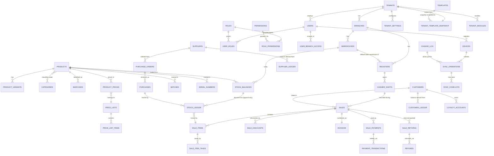

# ERD — Advanced Universal POS

Domain-level entity relationship diagram. Tables are introduced progressively per `docs/MASTER_PROMPT.md` section 7 and the phase table in section 12 — this is the structural map, not a final schema; each phase's migrations are the source of truth once written (see `docs/reports/phase-N.md` for what actually landed).

Every box below is implicitly scoped by `tenant_id` unless marked **(platform)**.

## Notes

- **Append-only ledgers** (`stock_ledger`, `customer_ledger`, `supplier_ledger`, `cash_movements`, `audit_logs`, `change_log`) have no update/delete edge into themselves on this diagram by design (G5, G9) — balances are always a derived `SUM()`, never a stored, independently-editable column.
- **Platform vs tenant**: `TENANTS`, `TEMPLATES`, `MODULE_DEFINITIONS`, `PLANS`, `PLATFORM_USERS` live outside any `tenant_id` scope and use a separate guard (section 5, "Identity"). No edge from a platform table reaches into tenant business data directly — only through the one-time, copy-on-onboarding `TENANT_TEMPLATE_SNAPSHOT` edge.
- **Held bills** (`held_sales`) are a separate table from `sales`, not a status on `sales` (section 7) — omitted above for brevity, same shape as `SALES` → `SALE_ITEMS` until resumed.
- The full column-level shape of each table is defined by its migration, not by this document; see `docs/data-dictionary.md` for the cross-cutting column conventions every table follows.
